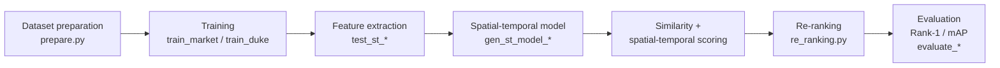

# Person Re-Identification System

M.Sc. project, Lakehead University. Implementation, training, and evaluation of a spatial-temporal person re-identification pipeline in PyTorch, on the Market-1501 and DukeMTMC-reID benchmarks.

# Overview

Person re-identification (re-ID) matches images of the same individual across non-overlapping camera views, under changes in viewpoint, lighting, and pose. Appearance alone is ambiguous: different people look similar, and the same person looks different across cameras. The spatial-temporal method addresses this by combining visual features with spatial-temporal information (which camera, at what time), narrowing the plausible gallery set before ranking, and applying re-ranking to the results.

This repository contains the working pipeline: data preparation, model definitions, training entry points for both datasets, spatial-temporal model generation, feature extraction/testing, evaluation, and re-ranking.

# Problem Statement

Given a query image, return the gallery images of the same person, ranked by likelihood, across a multi-camera network, at benchmark scale (tens of thousands of images), with quantitative evaluation (Rank-1 accuracy and mAP).

# Objectives

1. Stand up the full st-ReID pipeline (Wang et al., AAAI 2019) as working, runnable code.
2. Train and evaluate on Market-1501 and DukeMTMC-reID.
3. Generate spatial-temporal models and distribution analyses for both datasets.
4. Evaluate with and without re-ranking to isolate its effect.
5. Extend the model with colour histogram features (`model_chs.py`, `train_market_chsv.py`) and test whether the extension improves on the base configuration.

# Hardware Setup

Not hardware-dependent. Training/evaluation is GPU-oriented PyTorch work; no specific machine is required to read or adapt the code.

# Software Setup

- Python, PyTorch.
- Datasets (not included, obtain from their original sources for research use): Market-1501, DukeMTMC-reID. A CUHK03-NP preparation script from the extension work (`prepare_cuhk03.py`) is also included; that dataset is likewise external.
- Entry points: `prepare.py` (dataset preparation), `prepare_cuhk03.py` (CUHK03-NP preparation), `train_market.py` / `train_duke.py` / `train_market_chsv.py` (training), `gen_st_model_market.py` / `gen_st_model_duke.py` (spatial-temporal models), `test_st_market.py` / `test_st_duke.py` (feature extraction/testing), `evaluate_st.py`, `evaluate_rerank_market.py`, `evaluate_rerank_duke.py`, `gen_rerank_all_scores_mat.py` (evaluation and re-ranking), `plot_st_distribution.py` (distribution plots).
- `model.py` / `model_chs.py`: network definitions. `random_erasing.py`: data augmentation. `re_ranking.py`: re-ranking implementation.

# Architecture

# Methodology

Benchmark-standard protocol on both datasets: train on the dataset's training split, extract features for query and gallery sets, score with the joint visual + spatial-temporal similarity, optionally re-rank, and compute Rank-1 accuracy and mAP. Spatial-temporal distributions are generated from camera IDs and timestamps and plotted for inspection (`plot_st_distribution.py`).

Extension experiment (documented in my project report): a HistogramFeatureExtractor computes a normalized RGB colour histogram (256 bins per channel) for each image and concatenates it with the visual features. The base model and the histogram-augmented model were trained under an identical protocol for 60 epochs on Market-1501, with training and validation accuracy compared across epochs.

# Test Matrix

| Stage | Verification |
|---|---|
| Data preparation | Dataset directory structure produced for both benchmarks |
| Training | Models train to completion on Market-1501 and DukeMTMC-reID |
| Spatial-temporal modelling | Distribution models generated per dataset |
| Evaluation | Rank-1 / mAP computed via the evaluation scripts |
| Re-ranking | Evaluation repeated with re-ranking for comparison |

# Investigation Process

Not a debugging project; the investigative content is experimental. Two comparisons structure the project: (a) evaluation with and without the spatial-temporal component and with and without re-ranking, per dataset, to see where each stage contributes; (b) my extension experiment, base model versus colour-histogram-augmented model under an identical 60-epoch protocol, which produced a negative result, analysed in my project report.

# Evidence

- The complete pipeline code (18 modules, listed under Software Setup).
- My project report: "Matching Individuals Across Time and Space Using Person Re-Identification", M.Sc. project report, Lakehead University, included in this repository as `Nahiyan_Al_Mahmood_Final_Project_Report.pdf`. It documents the colour histogram extension, the experiment protocol, and the results reported below.
- Reference paper (the method's source publication): Wang et al., "Spatial-Temporal Person Re-Identification", AAAI 2019 (arXiv:1812.03282), included in this repository as `Spatial-Temporal_Person_Re-identification_report.pdf` for reference.
- Executed Colab notebooks from the project period (November 2023 to February 2024), preserved as run with their outputs, in `notebooks/` (see `notebooks/README.md` for provenance). They contain the dataset preparation, the training invocations used (PCB with ResNet50 and ResNet101 variants), training logs, and evaluation output obtained with the authors' pretrained checkpoint, plus a setup and run notebook for the PAUL comparison method.

# Results

Published results for the method (Wang et al.), reported for context and **not** as outputs of the runs in this repository:

| Dataset | Baseline Rank-1 | st-ReID Rank-1 (with random erasing + re-ranking) |
|---|---|---|
| Market-1501 | 91.2% | 98.1% |
| DukeMTMC-reID | 83.8% | 94.4% |

My experiment (from my project report): the colour histogram extension, with both configurations trained under an identical 60-epoch protocol on Market-1501. The figures are training and validation accuracy logged during training, **not** benchmark Rank-1/mAP:

| Configuration | Training accuracy, final epoch | Validation accuracy, final epoch |
|---|---|---|
| Base model (no histogram features) | 99.88% | 100% |
| With colour histogram features | 76.57% | 98.67% |

The extension did not improve on the base model in this experiment. My report analyses why: colour inconsistency across cameras and lighting conditions, and a mismatch between global histogram features and the model's partition-based local features. The histogram model learned more slowly but steadily; the report discusses this as a possible generalisation trade-off, stated there as a hypothesis, not a demonstrated result.

My work in this repository: implementation, training, and evaluation of the pipeline, the colour histogram extension experiment, and a comparison setup of a second published method (PAUL, see Basis & credit).

# Root Cause Analysis

Not applicable in the fault sense. The analytical question of the project is attribution of accuracy: appearance features alone plateau because of cross-camera ambiguity; the spatial-temporal constraint removes implausible matches before ranking, which is where the published gains come from. The same attribution discipline applies to the extension experiment: my report attributes the histogram model's negative result to feature compatibility and colour consistency, summarised under Results.

# Limitations

- This is an adaptation of a research codebase, not an original architecture (see Basis & credit). My contribution is implementation, training, evaluation, and analysis.
- Datasets are external and licence-restricted; they are not redistributed here.
- Benchmark Rank-1/mAP from my own runs are not claimed anywhere in this repository. The archived outputs are training logs, an evaluation obtained with the authors' pretrained checkpoint, and the training/validation accuracy comparison in my report. Each is labelled as what it is.

# Lessons Learned

- Evaluation discipline is test discipline: fixed splits, defined metrics, one change at a time, and comparing against the published baseline before believing any number.
- Provenance is part of the deliverable. Crediting the source method clearly costs nothing and makes the actual contribution legible.

# Future Work

- Run the extension experiment through full benchmark evaluation (Rank-1/mAP) with archived result files, to test the generalisation hypothesis in my report.
- Containerise the environment for one-command reproduction.

# Basis & credit

The code builds on the spatial-temporal person re-identification research codebase and method: Wang et al., "Spatial-Temporal Person Re-Identification", AAAI 2019. It is shared here as my M.Sc. project work, training, evaluation, and adaptation, not as an original-from-scratch implementation. A second published method, PAUL (Yang et al., "Patch-based discriminative feature learning for unsupervised person re-identification", CVPR 2019), was set up and run for comparison during the same project (notebooks/05); its code is third-party and is not included in this repository.
